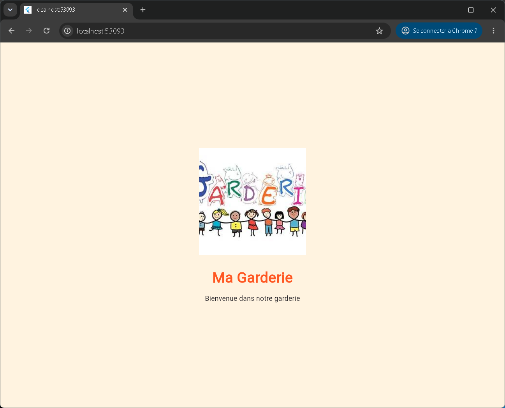
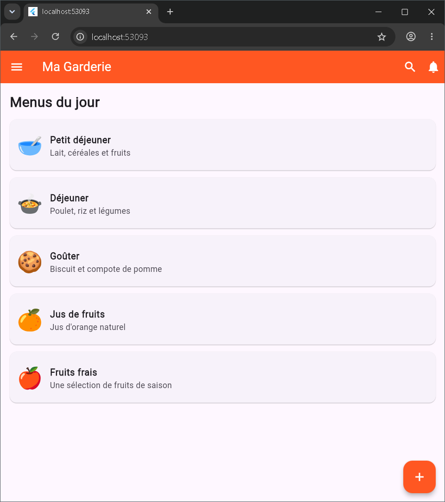
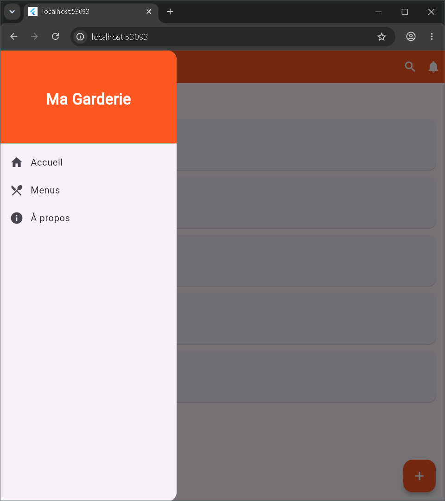
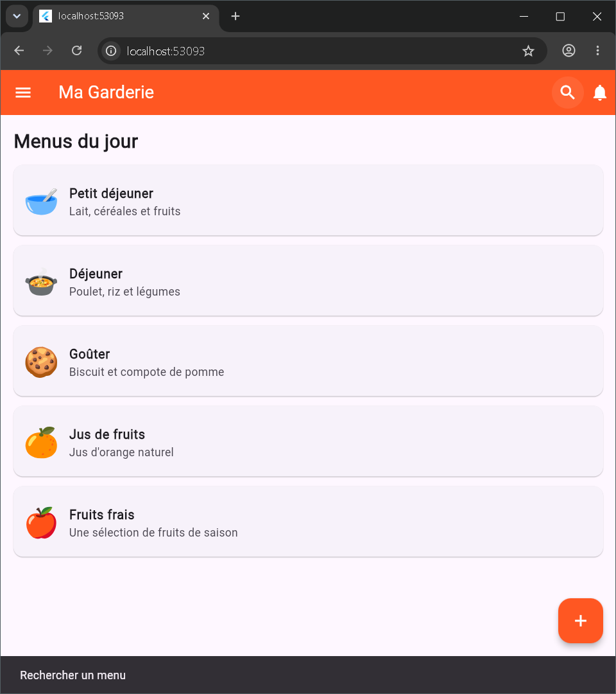

# Ma Garderie 🧸

## Présentation

Ma Garderie est une application mobile développée avec Flutter pour présenter les menus quotidiens d'une garderie d'enfants.

L'application contient un écran de démarrage, une page principale, une liste de menus, un Drawer de navigation et plusieurs interactions utilisateur.

## Fonctionnalités

- Splash Screen avec transition automatique après 3 secondes.
- AppBar avec les boutons Recherche et Notifications.
- Drawer avec Accueil, Menus et À propos.
- Liste des menus avec icône, titre et description.
- Floating Action Button pour ajouter un menu.
- Messages SnackBar lors des interactions.

## Technologies utilisées

- Flutter
- Dart
- Git
- GitHub

## Installation

1. Installer Flutter et configurer l'environnement.
2. Cloner le dépôt :

   ```bash
   git clone https://github.com/Gharbi-Ayoub/garderie-mobile-g2.git
   ```

3. Accéder au projet :

   ```bash
   cd ma_garderie
   ```

4. Installer les dépendances :

   ```bash
   flutter pub get
   ```

5. Lancer l'application sur un émulateur ou un appareil :

   ```bash
   flutter run
   ```

## Captures d'écran

### 1. Splash Screen



### 2. Page principale — Menus du jour



### 3. Drawer ouvert



### 4. Interaction — Message SnackBar



## Données

Les menus sont définis localement dans le code source. Aucun backend, aucune base de données et aucun système d'authentification ne sont utilisés.

## Auteur

Projet réalisé dans le cadre de l'épreuve pratique de Développement Mobile — 2ᵉ Groupe.
